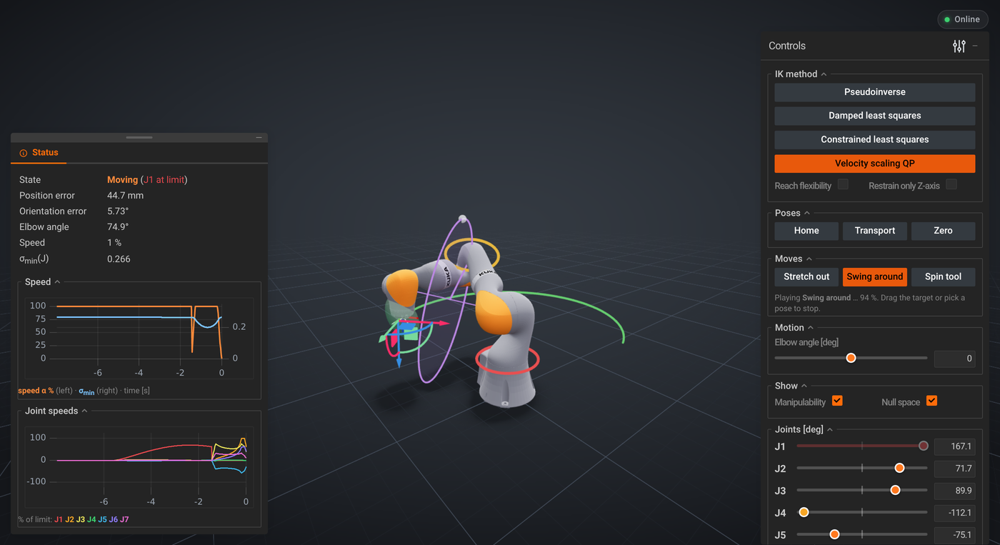

# KUKA iiwa14 IK Playground

Interactive, browser-based simulation of a KUKA LBR iiwa 14 for comparing
inverse-kinematics methods. Drag the tool, and watch four IK methods handle
singularities, joint limits and the 7th joint's redundancy, side by side with
their formulas.



## Quick start

```bash
git clone https://github.com/calvinsuzuki/iiwa-mujoco-viser.git
cd iiwa-mujoco-viser
./run.sh
```

That's all. The first run sets everything up (about 2 minutes) and later runs start
in seconds. `run.sh`:

1. checks for Python 3.10+ and git,
2. creates a private Python environment in `.venv/` (nothing installed system-wide),
3. installs the pinned packages from `requirements.txt`,
4. downloads the iiwa14 model from [MuJoCo Menagerie](https://github.com/google-deepmind/mujoco_menagerie) (~11 MB, fixed commit),
5. starts the app and opens your browser.

| Command | Does |
|---|---|
| `./run.sh` | start (Tailscale URL if Tailscale is running, else localhost) |
| `./run.sh --local` | localhost only |
| `./run.sh --port 8081` | another port (default 8080) |
| `NO_BROWSER=1 ./run.sh` | don't open a browser (e.g. over SSH) |

**Requirements:** Linux or macOS, Python 3.10 or newer, git, a modern browser.
On Ubuntu, if the environment can't be created: `sudo apt install python3-venv`.

### Opening it from another device

When [Tailscale](https://tailscale.com) is running, the app listens only on the
tailnet and prints a URL such as `http://<machine>.<tailnet>.ts.net:8080`. Any
device logged into the tailnet can open it, and the local Wi-Fi can't. Over
SSH, start it with `NO_BROWSER=1 ./run.sh` and open that URL on your laptop.
Everyone who opens it sees and drives the same robot.

## Using it

**Scene**
- **Gizmo at the tool:** drag the arrows to move the target (position exact,
  orientation may give way) or the rings to rotate it (the opposite).
- **Red sphere:** blinks when the target is clamped to the reachable workspace.
- **Ellipsoid:** translational manipulability. Round and green means the tool
  can move well in every direction; flat and red means near a singularity.
- **Violet circle:** the null space, where the elbow can swing while the tool
  stays put.
- **Rings on the joints:** amber when a joint is near its limit, red when it's at it.
- **Trail:** the tool path, coloured by IK method.

**Controls panel (right)**
- **IK method:** hover a button to see the method's formulas, its strong and
  weak points, and its core code.
- **Reach flexibility** / **Restrain only Z-axis:** let part of the pose give way
  (velocity scaling QP).
- **Poses:** Home, Transport (KUKA shipping pose), Zero (straight up, singular).
- **Moves:** scripted 6 s target paths that stress one weakness each. Run the
  same move with every method and compare.

  | Move | Tests |
  |---|---|
  | Stretch out | the stretched-arm singularity |
  | Swing around | the joint 1 limit |
  | Spin tool | the joint 7 limit |

- **Motion → Elbow angle:** swings the elbow through the null space.
- **Joints:** read or set each joint directly; a slider blinks red at its limit.

**Status and plots (bottom left):** the state ("Moving", "At target", "Can't
reach target", plus any joint at a limit), tracking errors, speed and σ<sub>min</sub>.
The plots show the last 8 s of tool speed and joint speeds; hover a plot and
click its expand icon for a large view with a legend.

## The four IK methods

All of them answer the same question each 10 ms step: which joint velocity `q̇`
makes the tool move with the commanded twist `V`, given `V = J(q) q̇`?

| Method | Idea | Typical failure |
|---|---|---|
| Pseudoinverse | `q̇ = J⁺V`, the minimum-norm exact solution | explodes at singularities, ignores limits |
| Damped least squares | `Δq = Jᵀ(JJᵀ + λ²I)⁻¹e`, iterated | inexact near singularities, can jump, ignores limits |
| Constrained least squares | `min ‖Jq̇ − V‖²` s.t. joint limits (QP) | the tool leaves its path when a limit is active |
| Velocity scaling QP | `max α` s.t. `Jq̇ = αV`, limits, null-space elbow | stops (α → 0) instead of finding a way around |

The velocity scaling QP is the formulation used by Drake's
`DifferentialInverseKinematics`. The details are in the docstrings of
`ik_solvers.py` and in the hover cards.

## Project structure

| File | Contents |
|---|---|
| `iiwa_core.py` | controller: target shaping, method dispatch, moves, status. No UI and no wall-clock time, so it also runs headless |
| `ik_solvers.py` | the four IK methods and the joint-limit box |
| `iiwa_viser.py` | the app: Viser server, control panel, update loop |
| `viser_scene.py` | 3-D scene: studio, robot meshes, overlays |
| `viser_style.py` | colours and the CSS injected into Viser's panel |
| `rotations.py` | quaternion helpers |
| `formulas/` | `make_formulas.py` renders the hover cards (LaTeX → SVG) |
| `dev_server.py` | development runner that restarts the app when a file changes |
| `run.sh` | setup and start |

**Libraries:** MuJoCo is the robot model and kinematics engine (forward
kinematics, Jacobians). No physics is stepped yet: the simulation is
kinematic. [Viser](https://viser.studio) is the browser 3-D viewer and GUI.
OSQP solves the QPs.

**Extending:**
- New move: a path function plus one `MOVES` entry in `iiwa_core.py`; its
  button appears automatically.
- New IK method: a solver in `ik_solvers.py`, a `METHODS` entry, and a branch
  in `IKController._joint_velocity`.

## Development

```bash
.venv/bin/python dev_server.py --port 8080    # restarts the app on every save
.venv/bin/python formulas/make_formulas.py    # rebuild the hover cards
```

Rebuilding the formula cards needs `pdflatex` (with the standalone, listings,
enumitem and koma-script packages) and `pdftocairo` (poppler-utils). The
generated SVGs are committed, so running the app doesn't need LaTeX.

## Troubleshooting

| Problem | Fix |
|---|---|
| "could not create a virtual environment" | `sudo apt install python3-venv` |
| Packages from ROS or another Python leak in | `run.sh` already unsets `PYTHONPATH`; start the app with `./run.sh` |
| Page loads but the robot is slow or choppy | the browser is using software WebGL: enable hardware acceleration |
| URL doesn't open from another device | is Tailscale running on both? Otherwise use `--local` on the same machine |
| Broken setup | `rm -rf .venv third_party && ./run.sh` |

## Credits

- Robot model: KUKA iiwa 14 from [MuJoCo Menagerie](https://github.com/google-deepmind/mujoco_menagerie/tree/main/kuka_iiwa_14) (BSD-3-Clause, derived from Drake).
- Transport pose: KUKA, *Spezifikation LBR iiwa*, V8, 03.05.2019, sec. 7.1.1.
- KUKA and LBR iiwa are trademarks of KUKA AG. This is an independent university project.
